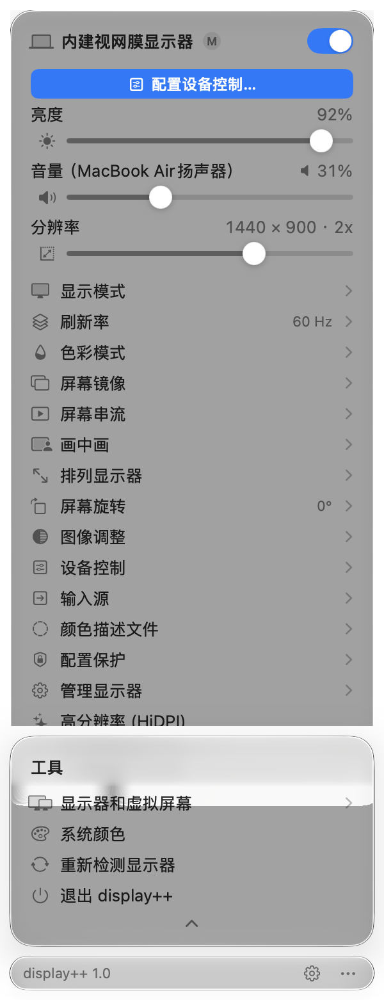

# display++

A macOS menu bar controller for attached displays: resolution, refresh rate,
HiDPI backing scale, brightness, volume, mirroring and arrangement — built
directly on CoreGraphics, SkyLight, IOKit and CoreAudio. No dependencies, no
Xcode project, no SwiftPM manifest.



<sub>简体中文说明见 [README.zh-CN.md](README.zh-CN.md) · Platform wording: the
panel is rendered offscreen by `--render`, so this image needs no screen
recording permission.</sub>

---

## What it is

A single menu bar item that opens a panel with one block per display: a header
with the display name and a target switch, brightness and volume sliders,
resolution, and a menu of display actions. Alongside it sits a seven-pane
settings window (displays, groups, applications, menu, keyboard, pro, about).

The interesting part is not the UI — it is that almost every control in the
panel maps to an API that either works, or silently fails, or succeeds and then
reverts. This project prefers to show you which one you got instead of pretending:
when external brightness falls back to gamma-table dimming it says *亮度（软件）*
and explains that the backlight does not change, rather than styling the fallback
as hardware control.

Everything here is an independent implementation against the macOS display
stack. Where a control cannot be made to work on a given panel, it is greyed out
with the reason in the row, not wired to a switch that does nothing.

## Requirements

| | |
|---|---|
| Mac | Apple Silicon (the build target is `arm64-apple-macos26.0`) |
| OS | macOS 26.0 or newer (the panel uses `NSGlassEffectView`) |
| Toolchain | Xcode Command Line Tools — full Xcode is **not** required |

## Build and run

```bash
git clone https://github.com/qingmin-new/mac-display-plus.git
cd mac-display-plus
./build.sh
open "build/display++.app"
```

`./build.sh` compiles every source file with `swiftc -O`, assembles
`build/display++.app`, generates the app icon on first run, and ad-hoc signs the
bundle. It takes about half a minute from clean. There is no Dock icon
(`LSUIElement`); the app lives in the menu bar.


## Features

| Capability | State | How |
|---|---|---|
| Menu bar resident, no Dock icon | ✅ | `NSStatusItem` + `LSUIElement` |
| Glass panel, one block per display | ✅ | `NSGlassEffectView` (macOS 26+) |
| Resolution list incl. HiDPI variants | ✅ | `kCGDisplayShowDuplicateLowResolutionModes` |
| Resolution switching | ✅ | bracketed transaction, `.permanently` |
| Refresh rate switching | ✅ | same transaction as the mode |
| Native-aspect-ratio filtering | ✅ | 16:9 panels hide 4:3 and 5:4 entries that would stretch |
| Row-level mode application | ✅ | retries every refresh/pixel variant before failing the row |
| HiDPI toggle, same point size | ✅ | switches to the mode with identical timing, so the link never retrains |
| Flexible scaling (HiDPI where the panel has no 2x mode) | ✅ | virtual display + mirror to synthesise the mode, then bind it in one transaction |
| Built-in display brightness | ✅ | `DisplayServicesSetBrightness` (private, via `dlsym`) |
| External DDC brightness and contrast | ⚠️ | IOKit `DCPAVServiceProxy` → `IOAVServiceWriteI2C`; depends on the cable and on the monitor answering |
| Software dimming fallback | ✅ | gamma transfer table, labelled as software |
| Volume: DDC → CoreAudio → none | ✅ | per-display backend chosen in that order, and named in the row |
| Brightness / volume / mute hotkeys | ✅ | `CGEventTap` on `NX_SYSDEFINED`, with an OSD; off means keys pass through |
| OSD | ✅ | separate borderless window, 1.1 s fade |
| Mirroring | ✅ | `CGConfigureDisplayMirrorOfDisplay` inside a transaction |
| Disconnect / reconnect | ✅ | private `CGSConfigureDisplayEnabled`, transaction form only |
| Arrangement in 20 pt steps | ✅ | whole group's origins rewritten in one transaction |
| Input source switching | ✅ | DDC 0x60 |
| Hot-plug handling | ✅ | `CGDisplayRegisterReconfigurationCallback`, 350 ms debounce |
| Refused modes self-heal | ✅ | a mode that fails to apply is remembered and removed from the list |
| Panel stays onscreen across mode changes | ✅ | geometry recomputed from the current screen, clamped on both axes |
| Picture-in-picture / streaming | ✅ | `SCShareableContent` → `SCStream` → `AVSampleBufferDisplayLayer` |
| Colour profile switching | ❌ | macOS rejects the write for non-entitled processes; the row explains why and opens the system pane instead |
| English / Simplified Chinese | ✅ | `en.lproj` + `zh-Hans.lproj`, follows the system language |

## CLI diagnostics

The app doubles as its own test harness. Every flag prints measured values
rather than asserting on internal state, because in this area the interesting
failures are "the API returned `kCGErrorSuccess` and the display did something
else".

```bash
APP="build/display++.app/Contents/MacOS/display++"

"$APP" --probe                            # displays, mode counts, HiDPI, DDC status
"$APP" --selftest                         # panel layout and visibility
"$APP" --geometry-test                    # panel fits 7 synthetic screen sizes
"$APP" --render /tmp/panel.png            # offscreen render, no permissions needed

"$APP" --set-mode 2 1600x900              # set display 2, preferring HiDPI
"$APP" --test-mode                        # switch once and back, print CGError
"$APP" --hidpi-test 2                     # same points, double pixels, then restore
"$APP" --hidpi-matrix 2                   # which point sizes can toggle at all
"$APP" --test-hidpi 2                     # toggle without changing output timing
"$APP" --flex-hidpi 2 1600x900            # synthesise a 2x mode via virtual display
"$APP" --drag-test                        # a swept slider commits exactly once
"$APP" --audit-modes 2                    # per row: which variants actually apply
"$APP" --software-test 2                  # gamma table really changed and restored
"$APP" --control-test                     # mirror / volume / virtual display, then restore
"$APP" --control-test --include-disconnect
"$APP" --arrangement-test 2               # 3 cycles, no cumulative drift
"$APP" --overflow-test                    # shrink the screen live, panel follows
"$APP" --persist-check 2 1920x1080        # session-scoped vs persisted mode
"$APP" --key-test                         # hotkey capture and volume stepping
"$APP" --menu-rows                        # which rows are visible and why
"$APP" --probe-virtual                    # virtual display creation report
"$APP" --move 2 -347 -1080                # move a display to global coordinates
```

Tests that mutate display state restore it before exiting, including on failure.
Debug `CGError` logging with `DPP_DEBUG=1`.

## Architecture

```
Sources/DisplayPlusPlus/
├── main.swift              entry point, CLI dispatch
├── AppDelegate.swift       status item, hotkeys, settings window
├── Model/                  value types (deliberately hold no CGDisplayMode)
│   ├── DisplayModeInfo.swift
│   └── DisplayDevice.swift
├── Services/               everything that mutates display state
│   ├── DisplayManager.swift      enumeration, modes, switching, hot-plug
│   ├── DisplayModeTable.swift    SkyLight mode table (private)
│   ├── DisplayControl.swift      mirror, disconnect, arrangement
│   ├── FlexibleScaling.swift     virtual display + bind
│   ├── DDCService.swift          IOAVService + I2C frames
│   ├── BrightnessService.swift   DisplayServices with gamma fallback
│   ├── AudioService.swift        CoreAudio per-display volume
│   ├── ColorService.swift        ColorSync profiles (read-only)
│   ├── StreamService.swift       ScreenCaptureKit → PiP
│   ├── VirtualScreenService.swift
│   └── MediaKeyTap.swift
├── UI/                     AppKit + SwiftUI; read state, call intents
└── Support/                CLI probes, localisation, @State replacement
```

`DisplayManager` is the only place that changes display state. Views read model
state and call intent methods; they never touch CoreGraphics directly.

Two conventions worth knowing before you read the code:

- **`@State` is not used.** In the macOS 26/27 SDK it is a macro whose plugin
  (`SwiftUIMacros`) ships with Xcode, not with the Command Line Tools. This
  project uses `@StateObject` + `StateBox<Value>` instead, read and written
  through `.value`.
- **`CGDisplayMode` never escapes a function.** It is not toll-free bridged and
  its handle is owned by the array returned from
  `CGDisplayCopyAllDisplayModes`. Carrying one out of scope still allows reading
  its properties, but applying it returns `kCGErrorIllegalArgument (1001)`.

## Private APIs

The public CoreGraphics surface cannot express HiDPI backing scale on external
displays, DDC brightness, or display disconnect, so this project calls:

- `CGSGetNumberOfDisplayModes` / `CGSGetDisplayModeDescriptionOfLength` / `CGSConfigureDisplayMode` (SkyLight)
- `CGSConfigureDisplayEnabled`, `CGSConfigureDisplayRotation` (SkyLight)
- `DisplayServices{Get,Set,CanChange}Brightness` (DisplayServices.framework)
- `CGVirtualDisplay*` (SkyLight)
- `IOAVServiceCreateWithService`, `IOAVServiceReadI2C`, `IOAVServiceWriteI2C` (IOKit)

These are undocumented, they are not covered by any compatibility promise, and
they can vanish between releases. Every call site is expected to fail gracefully
rather than crash. The notes in
[docs/display-api-notes.md](docs/display-api-notes.md) record the failure modes
that took the longest to find.

## Known limitations

- Ad-hoc signed and not notarised. Copying the bundle to another Mac will hit
  Gatekeeper.
- Hotkey capture needs the Accessibility permission. Without it the app leaves
  the keys with the system instead of swallowing them.
- Display identity is remembered by `CGDirectDisplayID`, which can change after
  reconnecting a dock. EDID-serial persistence is not implemented.
- Colour profile writes are blocked by macOS for processes without a ColorSync
  entitlement, so that row is read-only and links to the system pane.
- Virtual displays can be created, but they cannot remove the blanking on a mode
  change: mirroring into one forces the physical display onto the same timing,
  which is still a physical mode change. A compositor-based pipeline would be
  needed, with the latency and protected-content costs that implies.
- External DDC depends on the physical link. A USB-C → HDMI active adapter that
  does not forward DDC/CI returns a constant empty frame (`6e 80 be`) no matter
  what is written; EDID reads on the same link still work, which makes it look
  like a software bug for a long time.

## Related projects

- [MonitorControl](https://github.com/MonitorControl/MonitorControl) — DDC
  brightness/volume for external displays, GUI and CLI.
- [BetterDisplay](https://github.com/waydabber/BetterDisplay) — commercial, far
  broader in scope (flexible scaling, colour, streaming, network control).

This project is not affiliated with either of them, or with Apple.

## License

MIT — see [LICENSE](LICENSE).
