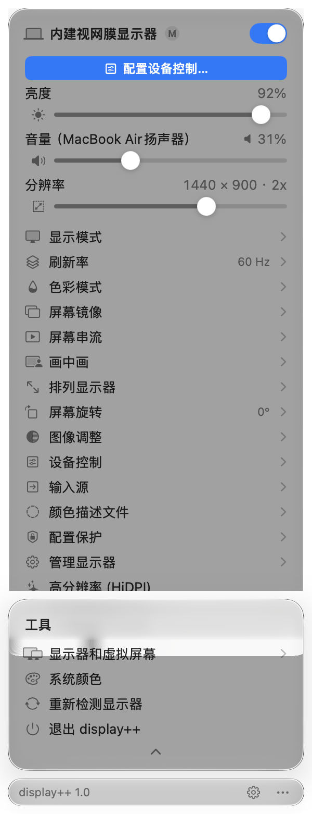

# display++

macOS 菜单栏显示器控制器：分辨率、刷新率、HiDPI 背板缩放、亮度、音量、镜像与排列，
直接建立在 CoreGraphics / SkyLight / IOKit / CoreAudio 之上。零第三方依赖、没有 Xcode 工程、
没有 SPM 清单。



<sub>English: [README.md](README.md)</sub>

---

## 这是什么

一个菜单栏图标，点开是一个面板，每块显示器一段：名称 + 开关的头部、亮度与音量滑块、
分辨率、一组显示器操作。旁边是一个七面板的设置窗口（显示器 / 显示组 / 应用程序 / 菜单 /
键盘 / 专业版 / 关于）。

有意思的不是界面 —— 是面板里几乎每个控件都对应一个**要么有效、要么静默失败、要么成功之后
又自己回退**的 API。本项目选择把「你拿到的是哪一种」说出来，而不是假装都一样：外接屏亮度
退化到 gamma 调光时，标题写「亮度（软件）」并写明背光不会变，不会把回退伪装成硬件控制。

所有功能都是针对 macOS 显示栈的独立实现。某个控件在当前面板上确实做不到时，它会被置灰并在
行内写明原因，而不是接一个按了没反应的开关。

## 环境要求

| | |
|---|---|
| 机器 | Apple Silicon（构建目标 `arm64-apple-macos26.0`） |
| 系统 | macOS 26.0 及以上（面板使用 `NSGlassEffectView`） |
| 工具链 | Xcode Command Line Tools —— **不需要**完整 Xcode |

## 构建与运行

```bash
git clone https://github.com/qingmin-new/mac-display-plus.git
cd mac-display-plus
./build.sh
open "build/display++.app"
```

`./build.sh` 用 `swiftc -O` 编译全部源码、组装 `build/display++.app`、首次运行生成图标、
并对 bundle 做 ad-hoc 签名。冷启动约 15 秒。没有 Dock 图标（`LSUIElement`），常驻菜单栏。

## 功能

| 能力 | 状态 | 实现要点 |
|---|---|---|
| 菜单栏常驻、无 Dock 图标 | ✅ | `NSStatusItem` + `LSUIElement` |
| 玻璃面板，每台显示器一块 | ✅ | `NSGlassEffectView`（macOS 26+） |
| 分辨率列表（含 HiDPI 变体） | ✅ | `kCGDisplayShowDuplicateLowResolutionModes` |
| 分辨率切换 | ✅ | 事务提交，`.permanently` 落盘 |
| 刷新率切换 | ✅ | 与模式写在同一个事务里 |
| 只列原生宽高比 | ✅ | 16:9 屏不再出现会被拉伸的 4:3 / 5:4 条目 |
| 行级模式应用 | ✅ | 逐刷新率/像素变体重试，全被拒才判该行不可用 |
| HiDPI 开关（点数不变） | ✅ | 切到输出时序相同的配对模式，链路不重新训练、不黑屏 |
| 灵活缩放（面板没有 2x 模式时合成） | ✅ | 建虚拟屏 + 镜像合成出模式，再单事务绑定 |
| 内建屏亮度 | ✅ | `DisplayServicesSetBrightness`（私有，`dlsym`） |
| 外接屏 DDC 亮度/对比度 | ⚠️ | IOKit `DCPAVServiceProxy` → `IOAVServiceWriteI2C`，取决于线材与显示器是否应答 |
| 软件调光回退 | ✅ | gamma transfer table，界面明确标注为软件 |
| 音量：DDC → CoreAudio → 无 | ✅ | 每屏按此顺序选后端，选中的那条写在行标题里 |
| 亮度 / 音量 / 静音热键 | ✅ | `CGEventTap` 捕获 `NX_SYSDEFINED`，带 OSD；关掉则按键穿透给系统 |
| OSD | ✅ | 独立无边框窗口，1.1 s 淡出 |
| 镜像 | ✅ | `CGConfigureDisplayMirrorOfDisplay` 在事务里提交 |
| 断开 / 重连 | ✅ | 私有 `CGSConfigureDisplayEnabled`，只能用事务形式 |
| 排列（20 pt 步进） | ✅ | 整组原点在同一次事务里重写 |
| 输入源切换 | ✅ | DDC 0x60 |
| 热插拔 | ✅ | `CGDisplayRegisterReconfigurationCallback`，350 ms 去抖 |
| 被拒模式自愈 | ✅ | 设不上的模式记入黑名单并从列表移除 |
| 改分辨率时面板不出屏 | ✅ | 每次按当前屏幕重算几何，双轴夹紧 |
| 画中画 / 串流 | ✅ | `SCShareableContent` → `SCStream` → `AVSampleBufferDisplayLayer` |
| 颜色描述文件切换 | ❌ | macOS 拒绝无 ColorSync entitlement 的进程写入；行内给说明并跳系统面板 |
| 简体中文 / English | ✅ | `en.lproj` + `zh-Hans.lproj`，跟随系统语言 |

## 命令行诊断

应用本身就是自己的测试工具。每个开关打印**实测值**，而不是对内部状态断言 —— 这一块的典型
故障恰恰是「API 返回 `kCGErrorSuccess`，显示器干了别的事」。

```bash
APP="build/display++.app/Contents/MacOS/display++"

"$APP" --probe                            # 显示器、模式数、HiDPI 数、DDC 状态
"$APP" --selftest                         # 面板布局尺寸与可见性
"$APP" --geometry-test                    # 7 种屏幕尺寸下面板不溢出
"$APP" --render /tmp/panel.png            # 离屏渲染，不需要屏幕录制权限

"$APP" --set-mode 2 1600x900              # 设 2 号屏，优先 HiDPI
"$APP" --test-mode                        # 切一次再切回，打印 CGError
"$APP" --hidpi-test 2                     # 点数不变、像素翻倍，然后还原
"$APP" --hidpi-matrix 2                   # 哪些点数尺寸真的能开 HiDPI
"$APP" --test-hidpi 2                     # 不改输出时序地来回切
"$APP" --flex-hidpi 2 1600x900            # 用虚拟屏合成一个 2x 模式
"$APP" --drag-test                        # 拖动滑块全程只提交一次
"$APP" --audit-modes 2                    # 逐行审计：哪些变体真能应用
"$APP" --software-test 2                  # 读回 gamma 表验证生效且可还原
"$APP" --control-test                     # 镜像 / 音量 / 虚拟屏，会改动并还原
"$APP" --control-test --include-disconnect
"$APP" --arrangement-test 2               # 3 个循环，验证无累积漂移
"$APP" --overflow-test                    # 实时缩小屏幕，验证面板跟随
"$APP" --persist-check 2 1920x1080        # 会话级 vs 持久化两种切法对比
"$APP" --key-test                         # 热键接管与音量步进
"$APP" --menu-rows                        # 哪些菜单行可见、为什么
"$APP" --probe-virtual                    # 虚拟屏创建报告
"$APP" --move 2 -347 -1080                # 把某块屏移到指定全局坐标
```

会改动显示状态的测试在退出前一定还原，失败路径也一样。`DPP_DEBUG=1` 打开 `CGError` 日志。

## 代码结构

```
Sources/DisplayPlusPlus/
├── main.swift              入口 + 命令行分发
├── AppDelegate.swift       菜单栏项、热键、设置窗口
├── Model/                  纯值类型（刻意不持有 CGDisplayMode）
├── Services/               所有改动显示状态的地方
│   ├── DisplayManager.swift      枚举、模式、切换、热插拔
│   ├── DisplayModeTable.swift    SkyLight 模式表（私有）
│   ├── DisplayControl.swift      镜像、断开、排列
│   ├── FlexibleScaling.swift     虚拟屏 + 绑定
│   ├── DDCService.swift          IOAVService + I2C 帧
│   ├── BrightnessService.swift   DisplayServices 与 gamma 回退
│   ├── AudioService.swift        CoreAudio 每屏音量
│   ├── ColorService.swift        ColorSync 描述文件（只读）
│   ├── StreamService.swift       ScreenCaptureKit → 画中画
│   ├── VirtualScreenService.swift
│   └── MediaKeyTap.swift
├── UI/                     AppKit + SwiftUI，只读状态、只调意图
└── Support/                CLI 探针、本地化、@State 替代
```

`DisplayManager` 是唯一改动显示状态的地方；视图只读状态、只调意图方法，不直接碰 CoreGraphics。

读代码前值得知道的两个约定：

- **不用 `@State`。** 在 macOS 26/27 SDK 里它是宏，插件 `SwiftUIMacros` 随 Xcode 提供，
  Command Line Tools 里没有。本项目用 `@StateObject` + `StateBox<Value>`，读写走 `.value`。
- **`CGDisplayMode` 不出函数作用域。** 它不是 toll-free bridged，句柄归
  `CGDisplayCopyAllDisplayModes` 返回的数组所有。把它带出作用域后属性仍能读，但应用时返回
  `kCGErrorIllegalArgument (1001)`。

## 私有 API

公开的 CoreGraphics 接口无法表达外接屏的 HiDPI 背板缩放、DDC 亮度和显示器断开，所以本项目调用：

- `CGSGetNumberOfDisplayModes` / `CGSGetDisplayModeDescriptionOfLength` / `CGSConfigureDisplayMode`（SkyLight）
- `CGSConfigureDisplayEnabled`、`CGSConfigureDisplayRotation`（SkyLight）
- `DisplayServices{Get,Set,CanChange}Brightness`
- `CGVirtualDisplay*`（SkyLight）
- `IOAVServiceCreateWithService`、`IOAVServiceReadI2C`、`IOAVServiceWriteI2C`（IOKit）

这些接口没有文档、没有任何兼容性承诺，且可能随系统版本消失。每处调用都要求**优雅失败而不是
崩溃**。最花时间才查清的那些失败方式记在
[docs/display-api-notes.md](docs/display-api-notes.md)（英文）。

## 已知限制

- ad-hoc 签名，未公证。把 bundle 拷到别的 Mac 会被 Gatekeeper 拦。
- 热键接管需要「辅助功能」权限；未授权时把按键交回系统，不会吞掉。
- 显示器身份按 `CGDirectDisplayID` 记忆，插拔扩展坞后可能变化；EDID 序列号持久化未做。
- 颜色描述文件写入被 macOS 拒绝（需要 ColorSync entitlement），该行只读并给系统入口。
- 虚拟屏能建，但不能用来消除改分辨率时的黑屏：把物理屏镜像进虚拟屏会强制它跟着切时序，
  仍然是物理模式变更。要走合成器那条路，代价是多一层捕获/合成延迟与受保护内容限制。
- 外接 DDC 取决于物理链路。不透传 DDC/CI 的 USB-C → HDMI 主动转换器会恒定返回空帧
  （`6e 80 be`），而同一条链路上的 EDID 读取仍然正常 —— 这个组合会长时间伪装成软件 bug。

## 相关项目

- [MonitorControl](https://github.com/MonitorControl/MonitorControl) —— 外接屏 DDC 亮度/音量，有 GUI 和 CLI。
- [BetterDisplay](https://github.com/waydabber/BetterDisplay) —— 商业软件，覆盖面大得多
  （灵活缩放、色彩、串流、网络控制）。

本项目与两者及 Apple 均无关联。

## 许可证

MIT —— 见 [LICENSE](LICENSE)。
